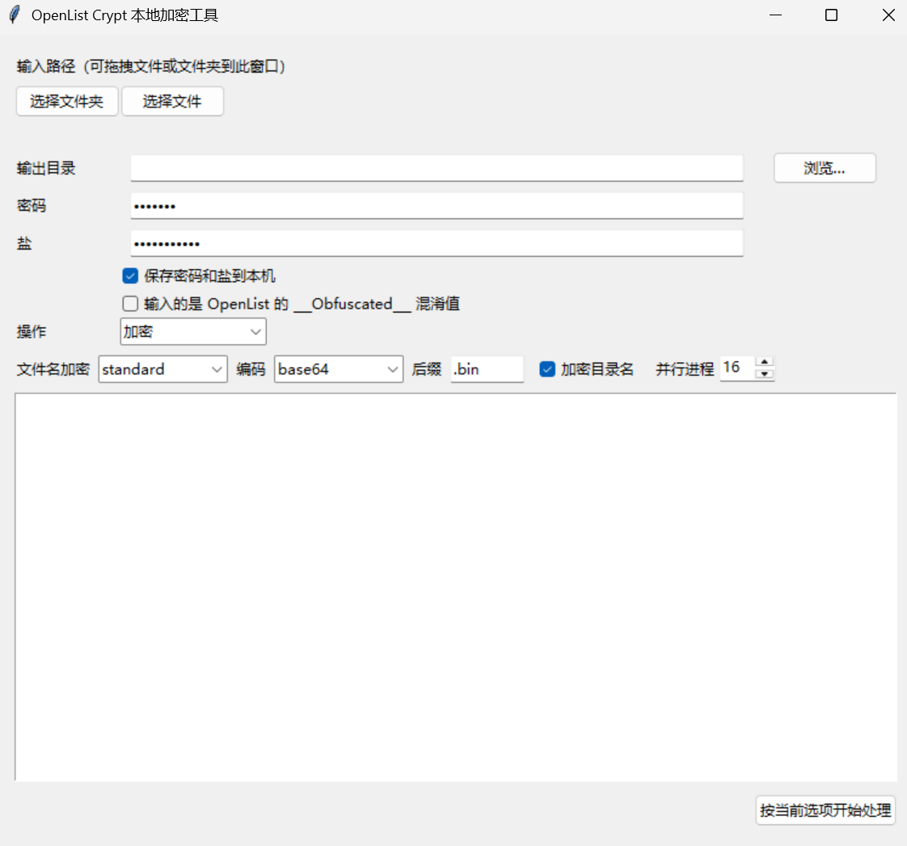

# OpenList Crypt 本地加密工具

一个适用于 Windows 的图形界面工具，用于在本地加密或解密文件和文件夹。项目使用现成的 rclone Crypt 兼容库处理加密数据和名称，可配合 OpenList Crypt 驱动使用。

这是独立的第三方项目，与 OpenList Team 无隶属、赞助或官方认可关系。此处提到 OpenList 仅用于说明配置和加密格式兼容性。

无需安装 Python：前往 [GitHub Releases](https://github.com/Ethan-Young-2004/openlist-crypt-local/releases) 下载最新版本中的 `OpenListCrypt.exe`，双击启动即可。



## 快速开始

1. 在“输入路径”区域点击“选择文件夹”或“选择文件”；也可以把文件或文件夹拖到窗口。
2. 在“输出目录”中选择结果保存位置。
3. 输入与 OpenList Crypt 一致的密码和盐。
4. 选择“加密”或“解密”，检查文件名、编码和目录名选项。
5. 设置并行进程数，然后点击右下角“按当前选项开始处理”。
6. 处理日志会显示已完成的文件；任务结束时会弹出完成提示。

工具不会覆盖输入文件，而是将处理结果写入所选输出目录。处理文件夹时会在输出目录下保留对应的顶层文件夹和内部目录结构。

## 界面选项

### 输入路径

- **选择文件夹**：递归处理文件夹内的文件和子文件夹。
- **选择文件**：只处理一个文件。
- **拖拽**：将文件或文件夹拖到窗口后，会自动开始处理。请先设置输出目录、密码和其他选项。

### 输出目录

选择加密或解密结果写入的目录。目录不存在时工具会尝试创建。

### 密码与盐

填写 OpenList Crypt 配置中的密码和盐。两者必须与加密时完全一致；解密时也要使用相同值。盐可以留空（对应 rclone 的默认盐），但使用 OpenList 配置时建议填入配置中的盐。

- **保存密码和盐到本机**：勾选后，程序会在此 Windows 用户的本地配置中保存这两个值，之后启动时自动填入。
- 保存文件路径：`%LOCALAPPDATA%\OpenListCrypt\settings.json`。
- 配置文件未加密。若其他人可以访问当前 Windows 用户配置目录，就可能读取其中的密码和盐。
- **输入的是 OpenList 的 ___Obfuscated___ 混淆值**：仅当填写的密码或盐带有 OpenList 导出值前缀 `___Obfuscated___` 时勾选。使用自己记住的明文密码和盐时不要勾选。

### 操作

- **加密**：读取明文文件，写出 OpenList Crypt 格式的加密文件。
- **解密**：读取加密文件，恢复明文内容和名称。

请使用独立的输出目录。解密时选中要解密的加密目录，输出目录中会还原其文件夹名称和内部层级。

### 文件名加密

- **standard**：使用标准文件名加密，通常是 OpenList Crypt 推荐模式。
- **obfuscate**：使用混淆式文件名处理。
- **off**：不加密文件名；加密时在原文件名后附加“后缀”，解密时移除该后缀。

文件名加密与解密必须选择相同模式。

### 编码

文件名编码格式，可选 `base64`、`base32` 或 `base32768`。必须与 OpenList Crypt 配置一致。常见配置使用 `base64`。

### 后缀

加密文件名模式设为 `off` 时，用此后缀标记加密文件，默认是 `.bin`。使用文件名加密模式时，此选项不参与文件名生成。

### 加密目录名

勾选后，目录名称（包括所选源文件夹的顶层名称）也会加密。解密时应保持勾选，程序才能还原目录名。若 OpenList Crypt 配置关闭了目录名加密，则取消勾选。

### 并行进程

设置处理文件夹时同时处理不同文件的进程数。默认值根据本机 CPU 核心数设定，最多默认 16；界面可设为 1 至 32。进程数越大，内存和 CPU 占用可能越高。若文件数量少于设置值，实际同时运行的进程数也会相应减少。

## OpenList 配置对应

将工具中的选项设置为与 OpenList Crypt 驱动相同的值：

| 工具选项 | OpenList Crypt 配置字段 |
| --- | --- |
| 文件名加密 | `filename_encryption` |
| 加密目录名 | `directory_name_encryption` |
| 编码 | `filename_encoding` |
| 后缀 | `encrypted_suffix` |
| 密码 | `password` |
| 盐 | `salt` |

例如，OpenList 配置为标准文件名加密、目录名加密、Base64 编码、后缀 `.bin` 时，工具对应选择 `standard`、勾选目录名加密、选择 `base64`，后缀填 `.bin`。

OpenList 导出的密码/盐若显示为 `___Obfuscated___...`，可原样粘贴并勾选“输入的是 OpenList 的 ___Obfuscated___ 混淆值”。

## 源码运行

需要 Windows 和 Python 3.10 或更高版本：

```powershell
python -m pip install -r requirements.txt
python OpenListCrypt.py
```

## 从源码构建 EXE

```powershell
python -m pip install pyinstaller
python -m PyInstaller --noconfirm --windowed --onefile --name OpenListCrypt --collect-all tkinterdnd2 OpenListCrypt.py
```

构建完成后，程序位于 `dist\OpenListCrypt.exe`。

## 项目文件

- `OpenListCrypt.exe`：可直接运行的 Windows 程序。
- `OpenListCrypt.py`：图形界面和处理逻辑源码。
- `requirements.txt`：源码运行所需的 Python 依赖。
- `screenshots/interface.png`：界面截图。

## 许可证

本项目源码采用 MIT License，详见 [LICENSE](LICENSE)。Windows 可执行文件捆绑了多个第三方依赖；分发时请同时保留 [第三方声明](THIRD_PARTY_NOTICES.md)，并遵守其中列出的上游许可证。OpenList 本身采用 AGPL-3.0；本项目未包含 OpenList 源码。
